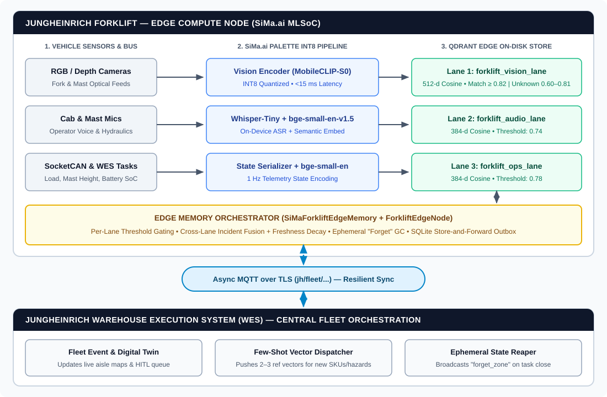
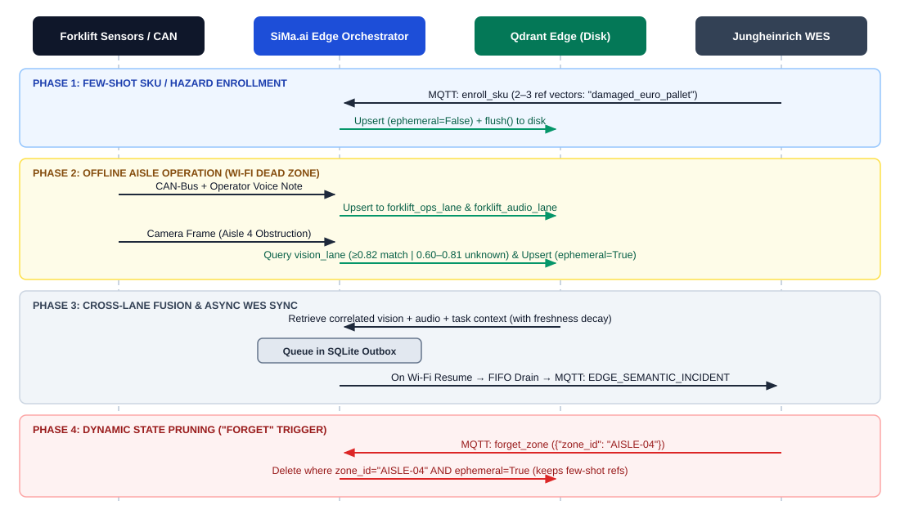

# SiMa.ai + Jungheinrich WES Edge-Native Semantic Memory

End-to-end prototype of **Edge-Native Semantic Memory for Autonomous Material Handling**, integrating **SiMa.ai MLSoC** on-device multimodal perception and **Qdrant Edge** vector memory with the **Jungheinrich Warehouse Execution System (WES)**.

The design combines the reference architecture in [SiMa_Jungheinrich_WES_Edge_Memory_Architecture.docx](./SiMa_Jungheinrich_WES_Edge_Memory_Architecture.docx) with the **Capture → Store → Recall → Forget** on-device memory pattern from DeepLearning.AI's *Building AI Assistants with On-Device Memory* ([`../on-device-mem/`](../on-device-mem/)).

---

## 1. System Architecture



### Core Architectural Principles

1. **Zero-Network Inference Loop**: Raw fork/mast camera frames, cab/hydraulic microphone audio, and 1 Hz SocketCAN telemetry are embedded locally on the SiMa.ai MLSoC (`<15 ms`) and persisted to on-disk Qdrant Edge storage. Raw media never traverses warehouse Wi-Fi.
2. **Multi-Lane Multimodal Telemetry Isolation**: Rather than mixing heterogeneous modalities into a single vector space (where high-variance visual embeddings can drown out structured CAN telemetry), each sensor stream writes to its own isolated Qdrant Edge collection (`forklift_vision_lane`, `forklift_audio_lane`, `forklift_ops_lane`) with its own dimension, encoder, and calibrated similarity threshold.
3. **Store-and-Forward Dead-Zone Resilience**: When Wi-Fi drops in cold-storage or metal-shielded aisles, the forklift continues local obstacle classification and queues outbound WES payloads in a durable `SQLiteOutbox`. Upon reconnection, queued events drain deterministically in FIFO order.
4. **Asymmetric Bandwidth Sync**: Only compact JSON payloads cross the MQTT over TLS bridge: `EDGE_SEMANTIC_INCIDENT` bundles, `EDGE_UNKNOWN_OBJECT` crops for human-in-the-loop (HITL) review, 2–3 few-shot reference vectors from WES, and zone-scoped `forget_zone` purge triggers.

---

## 2. Detailed Design & Data Schemas

### 2.1 Three Isolated Vector Lanes (`src/config.py`, `src/models.py`)

| Vector Lane | Edge Encoder | Dimensions & Metric | Match Threshold | Unknown Band | Operational Role |
| :--- | :--- | :--- | :--- | :--- | :--- |
| `forklift_vision_lane` | `MobileCLIP-S0` (INT8) | `512-d` Cosine | `0.82` | `0.60 – 0.81` | Few-shot SKU/pallet recognition, aisle obstruction & damage detection |
| `forklift_audio_lane` | `Whisper-Tiny` + `bge-small-en-v1.5` | `384-d` Cosine | `0.74` | — | Hands-free operator voice memos & hydraulic/mast acoustic anomalies |
| `forklift_ops_lane` | `StateSerializer` + `bge-small-en-v1.5` | `384-d` Cosine | `0.78` | — | SocketCAN load weight, mast height, battery SoC & active WES tasks |

#### Payload Schemas (`src/models.py`)
- **`VisionPayload`**: `lane="vision"`, `source_type` (`"few_shot_reference"` | `"live_observation"`), `label`, `zone_id`, `forklift_id`, `pose_xyz`, `timestamp_utc`, `timestamp_epoch`, `ephemeral`, `wes_task_id`, `severity`.
- **`AudioPayload`**: `lane="audio"`, `transcript`, `intent_tag`, `operator_id`, `zone_id`, `mast_height_mm`, `timestamp_utc`, `timestamp_epoch`, `ephemeral`, `synced_to_wes`.
- **`OpsTelemetryPayload`**: `lane="ops_telemetry"`, `wes_task_id`, `sku_id`, `action`, `zone_id`, `target_bin`, `load_weight_kg`, `mast_height_mm`, `hydraulic_pressure_bar`, `battery_soc_pct`, `semantic_summary`, `timestamp_utc`, `timestamp_epoch`, `ephemeral`, `status`.

### 2.2 Threshold Gating & Unknown-Object HITL Band (`src/memory/orchestrator.py`)

Every live camera frame is evaluated against `source_type="few_shot_reference"` vectors in `forklift_vision_lane`:
- **`score >= 0.82` (`MATCHED`)**: Recognized SKU or hazard. Persisted as a transient `live_observation` (`ephemeral=True`), correlated across all 3 lanes via `build_wes_incident_bundle()`, and published/queued as `EDGE_SEMANTIC_INCIDENT`.
- **`0.60 <= score < 0.82` (`UNKNOWN_OBJECT`)**: Ambiguous object below the safety confidence threshold. Emits `UnknownObjectEvent` (base64 ROI JPEG + `512-d` vector + candidate label) to `jh/fleet/{forklift_id}/edge/unknown_object` for WES human-in-the-loop labeling.
- **`score < 0.60` (`IGNORED`)**: Background noise; no network traffic or memory write.

### 2.3 Freshness Decay & Persistent On-Disk Store (`src/memory/store.py`)

Following the Lesson 5 `freshness_ranking` pattern from `on-device-mem/L5/helper.py`:
- When correlating `forklift_audio_lane` and `forklift_ops_lane` for a `zone_id`, candidate hits are re-ranked with an exponential recency bonus:
  $$\text{rank\_score} = \text{cosine\_sim} + w \cdot \exp\left(-\frac{\ln(2) \cdot \text{age}}{\text{half\_life}}\right)$$
  with default `half_life = 900s` (15 minutes) and `weight = 0.10`, ensuring the most recent cab voice note and active CAN task win ties over stale memories.
- `create_vector_store()` automatically uses `QdrantClientVectorStore` (`QdrantClient(path=...)`) when `qdrant-client` is installed, or falls back to `LocalDiskVectorStore` (a zero-dependency SQLite-persisted vector store implementing exact cosine similarity, payload filtering, and freshness decay).

### 2.4 Encoders (`src/pipeline/encoders.py`)

- `VisionEncoder`, `AudioEncoder`, and `TelemetryEncoder` wrap SiMa.ai Palette INT8 / `fastembed` (`Qdrant/clip-ViT-B-32-vision`, `BAAI/bge-small-en-v1.5`) when available, and include a deterministic L2-normalized n-gram projection fallback so the full prototype and test suite run offline without GPU/NPU hardware or model downloads.

### 2.5 WES Integration Interface — MQTT over TLS (`src/sync/mqtt_bridge.py`, `src/sync/outbox.py`)

| Direction | MQTT Topic | Payload | Trigger |
| :--- | :--- | :--- | :--- |
| Forklift → WES | `jh/fleet/{forklift_id}/edge/incident` | `EdgeSemanticIncident` | Vision match `>= 0.82` correlated with audio & CAN context |
| Forklift → WES | `jh/fleet/{forklift_id}/edge/unknown_object` | `UnknownObjectEvent` | Vision similarity in `0.60 – 0.81` HITL band |
| WES → Forklift | `jh/fleet/broadcast/edge/enroll_sku` | `EnrollSkuCommand` | 2–3 reference vectors pushed for new SKU/hazard |
| WES → Forklift | `jh/fleet/broadcast/edge/forget_zone` | `ForgetZoneCommand` | Zone cleared / task closed (`{"zone_id": "AISLE-04"}`) |

- **`PahoMqttTransport`**: Production `paho-mqtt` v2 (`CallbackAPIVersion.VERSION2`) client with TLS (`port=8883`, QoS 1).
- **`InMemoryMqttBus` & `InMemoryForkliftTransport`**: In-process pub/sub bus with `set_online(False/True)` to simulate Wi-Fi dead zones.
- **`SQLiteOutbox`**: Durable FIFO table (`PENDING` → `SENT`) that buffers outbound messages while offline and drains them in order upon reconnection.

---

## 3. End-to-End Operational Lifecycle (4 Phases)



1. **Phase 1 — Few-Shot SKU / Hazard Enrollment (`WES → Forklift`)**:
   - `JungheinrichWesSimulator.dispatch_few_shot_sku()` publishes 2–3 reference vectors for `"damaged_euro_pallet"` on `jh/fleet/broadcast/edge/enroll_sku`.
   - `EdgeMqttBridge` invokes `SiMaForkliftEdgeMemory.enroll_few_shot_object()`, writing points with `source_type="few_shot_reference"` and `ephemeral=False`, then calls `flush()` so they survive power cycles and battery swaps.
2. **Phase 2 — Offline Aisle Operation (Wi-Fi Dead Zone)**:
   - Transport goes offline (`transport.set_online(False)`).
   - `ForkliftEdgeNode.process_can_snapshot()` serializes 1 Hz SocketCAN telemetry (`TSK-88412`, `840 kg`, `AISLE-04`) into `forklift_ops_lane`.
   - `ForkliftEdgeNode.process_audio_clip()` transcribes the operator voice note (`"Broken pallet blocking bay 12 in aisle four"`) into `forklift_audio_lane`.
   - `ForkliftEdgeNode.process_camera_frame()` matches the live frame (`score >= 0.82`), records an `ephemeral=True` observation, builds the fused `EDGE_SEMANTIC_INCIDENT`, and queues it in `SQLiteOutbox`.
3. **Phase 3 — Reconnection & Store-and-Forward Drain**:
   - Transport comes back online (`transport.set_online(True)`).
   - `ForkliftEdgeNode.reconnect_and_sync()` drains `SQLiteOutbox` in FIFO order to `jh/fleet/JH-ETV-216i-09/edge/incident`.
   - `JungheinrichWesSimulator` receives the fused incident and updates its Digital Twin: `aisle_status["AISLE-04"] = "OBSTRUCTED:damaged_euro_pallet"`.
4. **Phase 4 — Dynamic State Pruning (`"Forget"` Trigger)**:
   - Once the aisle is cleared, `JungheinrichWesSimulator.broadcast_forget_zone("AISLE-04")` updates `aisle_status["AISLE-04"] = "CLEAR"` and broadcasts `{"zone_id": "AISLE-04"}` on `jh/fleet/broadcast/edge/forget_zone`.
   - `SiMaForkliftEdgeMemory.forget_zone_ephemeral_state("AISLE-04")` deletes all `ephemeral=True` points for `AISLE-04` across all 3 lanes while preserving the `ephemeral=False` few-shot reference vectors.

---

## 4. Repository Layout

```text
forklift/
├── README.md
├── pyproject.toml
├── SiMa_Jungheinrich_WES_Edge_Memory_Architecture.docx
├── docs/
│   ├── architecture.svg             # System architecture diagram
│   └── lifecycle_sequence.svg       # 4-phase sequence diagram
├── src/
│   ├── config.py                    # Lane configs, thresholds, MQTT topics
│   ├── models.py                    # Pydantic schemas for lanes & WES payloads
│   ├── runtime.py                   # ForkliftEdgeNode runtime orchestrator
│   ├── demo.py                      # End-to-end 4-phase lifecycle simulation
│   ├── pipeline/
│   │   ├── encoders.py              # MobileCLIP-S0 / Whisper+bge-small / StateSerializer
│   │   └── sensors.py               # CameraFrame, CabAudioClip, CanBusSnapshot
│   ├── memory/
│   │   ├── store.py                 # QdrantClientVectorStore & SQLite LocalDiskVectorStore
│   │   └── orchestrator.py          # SiMaForkliftEdgeMemory (gating, fusion, forget)
│   ├── sync/
│   │   ├── outbox.py                # Durable SQLiteOutbox (FIFO store-and-forward)
│   │   └── mqtt_bridge.py           # EdgeMqttBridge, PahoMqttTransport, InMemoryMqttBus
│   └── wes/
│       └── simulator.py             # JungheinrichWesSimulator (Digital Twin, Dispatcher, Reaper)
└── tests/
    └── test_edge_wes_lifecycle.py   # Lifecycle, HITL band, persistence, and freshness tests
```

---

## 5. Setup & Running the Prototype

### Prerequisites

- Python 3.11+
- Core dependencies: `pydantic>=2.0`, `paho-mqtt>=2.0`, `pytest>=8.0`
- Optional production backends: `qdrant-client`, `fastembed`

```powershell
cd C:\github\pai\forklift
pip install -e ".[dev]"
```

### Run the 4-Phase End-to-End Demo

```powershell
cd C:\github\pai\forklift
python -m src.demo
```

**Observed Output:**

```text
=== PHASE 1: Few-Shot SKU / Hazard Enrollment (WES -> Forklift) ===
Vision lane points after enrollment: 2

=== PHASE 2: Offline Aisle Operation (Wi-Fi Dead Zone) ===
Camera decision: MATCHED (damaged_euro_pallet, score=1.0)
Sync status while offline: QUEUED, outbox pending=1
WES incidents received while offline: 0

=== PHASE 3: Wi-Fi Restored -> Store-and-Forward Drain ===
Drained 1 outbox message(s), outbox pending=0
WES Digital Twin aisle_status: {'AISLE-04': 'OBSTRUCTED:damaged_euro_pallet'}
WES received incident: {'event_type': 'EDGE_SEMANTIC_INCIDENT', 'forklift_id': 'JH-ETV-216i-09', 'zone_id': 'AISLE-04', 'vision_classification': 'damaged_euro_pallet', 'vision_confidence': 1.0, 'operator_note': 'Broken pallet blocking bay 12 in aisle four', 'audio_confidence': 1.0, 'active_wes_task': 'TSK-88412', 'load_weight_kg': 840.0, 'timestamp_utc': '...'}

=== PHASE 4: Dynamic State Pruning ('Forget' Trigger) ===
WES Digital Twin aisle_status after clear: {'AISLE-04': 'CLEAR'}
Vision lane points remaining (permanent few-shot refs preserved): 2
```

### Run the Test Suite

```powershell
cd C:\github\pai\forklift
pytest -v
```

**Observed Output:**

```text
tests/test_edge_wes_lifecycle.py::test_full_four_phase_lifecycle PASSED  [ 33%]
tests/test_edge_wes_lifecycle.py::test_unknown_object_band_and_noise_rejection PASSED [ 66%]
tests/test_edge_wes_lifecycle.py::test_persistence_across_power_cycle_and_freshness_ranking PASSED [100%]

============================== 3 passed in 0.90s ==============================
```
